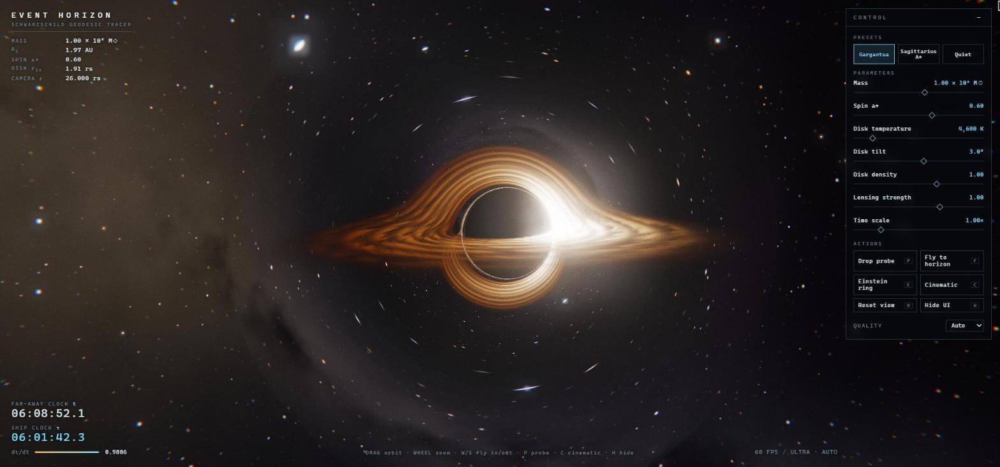

# Event Horizon



An interactive, real-time black hole simulator in Three.js and Vite. Every pixel is a light ray traced backwards along a Schwarzschild null geodesic. There are no texture files: the accretion disk, starfield, galaxy band, probe and post effects are all generated in shaders.

## Running it

```bash
npm install
npm run dev        # http://localhost:5173
npm test           # physics, preset, camera, quality and formatting tests (Vitest)
npm run build      # production build into dist/
npm run preview    # serve the production build
```

It needs a desktop browser with WebGL 2.

### Controls

| Input | Action |
| --- | --- |
| Drag | Orbit |
| Mouse wheel | Zoom |
| `W` / `S` (or ↑ / ↓) | Fly in / out |
| `A` / `D` (or ← / →) | Orbit left / right |
| `F` | Fly to the horizon, or back out if already there |
| `P` | Drop a probe |
| `E` | Line the camera up with the beacon star (Einstein ring) |
| `C` / `Esc` | Toggle cinematic mode / leave it |
| `R` | Reset the view |
| `H` | Hide or show the UI |

The control panel has sliders for **mass, spin, disk temperature, disk tilt, disk density, lensing strength and time scale**. It also has the presets **Gargantua**, **Sagittarius A\*** and **Quiet**, and a quality selector (Auto, or a fixed level).

## Project layout

```
src/
  physics/   blackhole.js   rs, time dilation, Doppler factor, ISCO, disk temperature, shadow size
             probe.js       radial free fall in distant-observer time, probe redshift
  shaders/   blackhole.frag.glsl   geodesic ray tracer, disk, sky, probe
             final.frag.glsl       ACES tone map, vignette, fringe, film grain, letterbox
  scene/     renderer.js    full-screen pass + bloom + final pass (EffectComposer)
             probe-controller.js, quality.js (adaptive quality)
  camera/    orbit-camera.js (orbit / zoom / fly-in), cinematic.js (scripted spline path)
  ui/        panel.js, hud.js, params.js (sliders + presets), format.js
  main.js    wires it all together
tests/       Vitest suites
```

## Units

The physics uses geometric units: **rs = 1** (so M = ½) and c = 1, with time measured in rs/c. On screen, the hole's size scales as (M / 10⁸ M☉)^¼. That compression keeps every mass from 10⁵ to 3×10¹⁰ M☉ in view. All HUD readouts use the true values: rs in km or AU, and clocks in seconds of rs/c for the chosen mass.

## The physics behind each effect

### Schwarzschild radius
`rs = 2GM/c²`. One solar mass gives 2.95 km. Sagittarius A* (4.3×10⁶ M☉) gives 1.27×10¹⁰ m, about 0.085 AU.

### Bending light: geodesic ray tracing
For a photon in the Schwarzschild metric, the orbit equation `d²u/dφ² + u = 3Mu²` (u = 1/r) is the same as motion under a Cartesian-looking acceleration:

```
a = −(3/2) h² r̂ / r⁴      with h = |r × v| (conserved)
```

The shader starts each ray at the camera and integrates it with a velocity-Verlet step. Step sizes shrink near the photon sphere. A ray is **captured** when r < rs and **escapes** once it leaves the region holding the disk and probe. The rest of the bending out to infinity is added analytically with the weak-field formula `Δ = (2M/b)(1 − p·v/r)`. *Lensing strength* scales the acceleration: 0 gives straight rays, 1 is physical.

Three things in the scene come straight out of this integration:

- **The shadow.** Rays with impact parameter below `b_c = 3√3/2 rs ≈ 2.6 rs` fall in. Note that the shadow is 2.6× the horizon's size.
- **The far side of the disk appears above and below the shadow.** Light from the back of the disk passes over (or under) the hole and is bent towards the camera. This gives the "Interstellar" halo. A ray may cross the disk plane several times; every crossing adds emission front to back.
- **Einstein rings and arcs.** A star directly behind the hole is imaged into a ring at the Einstein angle. Press `E` to line up the bright beacon star. Stars near the line of sight are stretched into arcs.

### Photon ring
Rays that skim the unstable photon orbit at r = 1.5 rs can circle the hole several times before escaping. They pile up into a thin, bright ring just outside the shadow edge. The tracer keeps each ray's minimum radius and adds a glow `∝ exp(−28 (r_min − 1.5))` to escaping rays. The secondary disk images that stack on that ring come from the integration itself.

### Accretion disk
- **Inner edge:** the prograde ISCO of a Kerr hole with spin a* (Bardeen–Press–Teukolsky). It is 3 rs at a* = 0 and shrinks with spin. The edge is clamped at 1.6 rs, just outside the Schwarzschild photon sphere, because the geodesics themselves are Schwarzschild (see *Approximations*).
- **Temperature profile:** the thin-disk (Shakura–Sunyaev / Novikov–Thorne) shape `T ∝ x^(−3/4) (1 − x^(−1/2))^(1/4)`, x = r/r_in. It peaks at x = 49/36, and the *disk temperature* slider sets that peak. The colour is a blackbody approximation.
- **Turbulence:** fbm noise in polar coordinates, rotating with the Keplerian angular velocity `Ω = √(M/r³)`. Inner rings orbit faster, so the pattern shears. Two noise phases cross-fade on a 60 rs/c cycle, which stops the shear from winding the noise into ever-thinner streaks.

### Relativistic Doppler beaming
Disk gas on a circular orbit moves at `β = √(rs / 2(r − rs))` relative to a static observer: c/2 at the Schwarzschild ISCO. The frequency ratio is

```
g = δ · √(1 − rs/r) / √(1 − rs/r_cam),    δ = 1 / (γ (1 − β cos θ))
```

These are the Doppler factor, the gravitational redshift at the emitter, and the blueshift for a camera deep in the potential. The observed temperature is `g · T`. Intensity scales as `g³`, because `I_ν/ν³` is invariant. The approaching side is brighter and bluer; the receding side is dimmer and redder. Above g = 2 the intensity factor is capped so the colour still shifts but the screen doesn't saturate.

### Time dilation and the fly-in
A static observer at radius r ages at `dτ/dt = √(1 − rs/r)`. The HUD shows a **far-away clock** (coordinate time t) and a **ship clock** (the camera's proper time τ). As you fly in, the ship clock falls behind. Near the horizon:

- Starlight is blueshifted and brightened (both capped for display).
- Stars smear into streaks along the great circle through the hole. The streak length grows with `1/√(1 − rs/r)`.
- The shadow's angular radius `sin α = b_c √(1 − rs/r) / r` grows past 90° inside the photon sphere and towards 180° at the horizon. Once it is wider than the frame, the camera pitches away from the hole, so the shadow edge stays in view and the screen doesn't go black.

### The probe
The probe is released from rest at r₀ and falls radially. Its fall is integrated in the **distant observer's** time:

```
dr/dt = −(1 − 1/r) √(1/r − 1/r₀) / E,     E = √(1 − 1/r₀)
dτ/dt = (1 − 1/r) / E
```

The integrator is RK4. Near the horizon, r − 1 decays like e^(−t): from the viewer's point of view the probe never crosses. The HUD shows its r, its dilation factor dτ/dt (→ 0), its redshift z (→ ∞), and its proper time, which stays finite. Proper time matches the analytic free-fall time to 0.01 rs/c, and the tests check this.

- **Redshift:** `g = (1 − 1/r) / (E + cos α · √(1/r − 1/r₀))`. This combines gravitational redshift with the Doppler shift of the infall. The ship's light is treated as a 6500 K blackbody shifted by g, so it turns orange, then deep red, and fades.
- **Stretching:** the ship is drawn as an ellipsoid that is part of the ray-traced scene, so it is lensed too. Its radial axis grows like `1 + 4/r³`, a stylised tidal stretch, and its transverse axes shrink to keep the volume constant.

### Post-processing
Unreal bloom, then a final pass: ACES filmic tone mapping, a slight radial chromatic fringe, vignette, luminance-weighted animated film grain and the cinematic letterbox.

### Adaptive quality
Five levels (Ultra → Potato) trade render scale, maximum ray steps, step size and noise octaves. The controller measures fps over 1-second windows:

- Two windows below **50 fps** drop one level.
- Six windows at 58 fps or more try one level up.
- If an upgrade is followed straight away by a downgrade, the upgrade wait doubles, so the level doesn't oscillate.
- A frame gap over 0.25 s (a hidden tab, a debugger pause) throws away the current window instead of counting as slow rendering.

## Approximations (honest list)
- The **geodesics are Schwarzschild**. Spin moves the disk's inner edge (Kerr ISCO) and adds a weak, phenomenological frame-dragging term `∝ a* (ŷ × v)/r³` to the ray acceleration. It does not trace Kerr geodesics, so the shadow stays circular.
- The disk is geometrically thin and optically semi-transparent. Its opacity is artistic.
- Doppler intensity above g = 2 is capped, and so is the camera blueshift of starlight.
- The probe's brightness falls as `g^0.75` instead of the physical `g⁴`, so the freeze stays visible for a few seconds. The colour shift uses the true g.
- The mass→size scaling on screen is compressed (M^¼).

## Verified on
Chrome with an NVIDIA GTX 1650 at 1920×897: a steady 60 fps at the Ultra level. With the render resolution forced up 3×, the auto-scaler stepped down from Ultra to Low (back above 50 fps). When the load was removed, it climbed back to Ultra.

## Original prompt

The project was built from this brief:

```text
Build "Event Horizon", an interactive real-time black hole simulator in Three.js with Vite. It must run at 60 fps in a desktop browser and use no external assets: every texture, star and effect is procedural.

The scene:

- A Schwarzschild black hole with a glowing, turbulent accretion disk, rendered with a raymarching fragment shader that bends light. The far side of the disk must appear above and below the shadow, as in Interstellar.

- Relativistic Doppler beaming: one side of the disk is brighter and bluer, the other dimmer and redder.

- A procedural starfield and galaxy band behind it that visibly lenses around the black hole, including an Einstein ring when a star aligns.

- A photon ring at the shadow's edge, plus bloom and film grain post-processing.

Interaction:

- Orbit, zoom and fly-in camera. Flying toward the horizon slows time on an on-screen clock and stretches the stars.

- A control panel for mass, spin, disk temperature, disk tilt, lensing strength and time scale, with presets "Gargantua", "Sagittarius A*" and "Quiet".

- A "drop a probe" button: a small ship falls in, stretches, redshifts and freezes at the horizon from the viewer's point of view.

- A cinematic mode that flies a slow, scripted camera path, for recording.

Quality:

- A clean, minimal sci-fi HUD with live readouts: mass, Schwarzschild radius, the probe's time dilation factor and fps.

- Automatic quality scaling if fps drops below 50.

- Split the code into modules: scene, shaders, physics, ui, camera.

- Write tests for the physics math (Schwarzschild radius, time dilation, Doppler factor) and the presets, plus a production build that passes.

- Write a README with how to run it and the physics behind each effect.

When you finish, run the tests and the build, open it in a browser to check it renders, and report what works.
```
